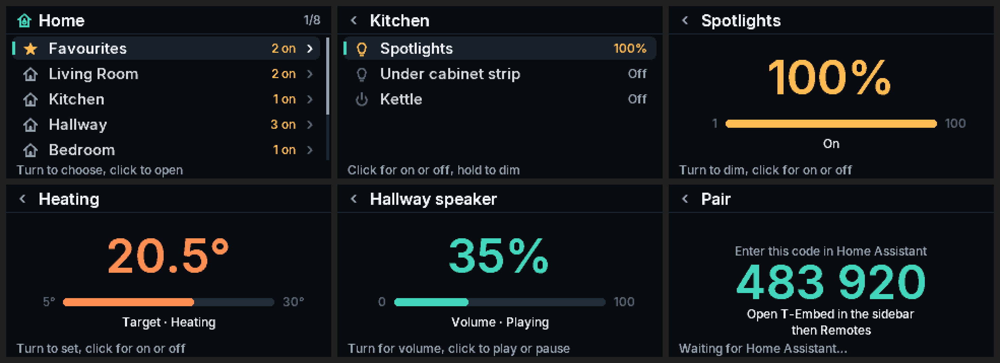
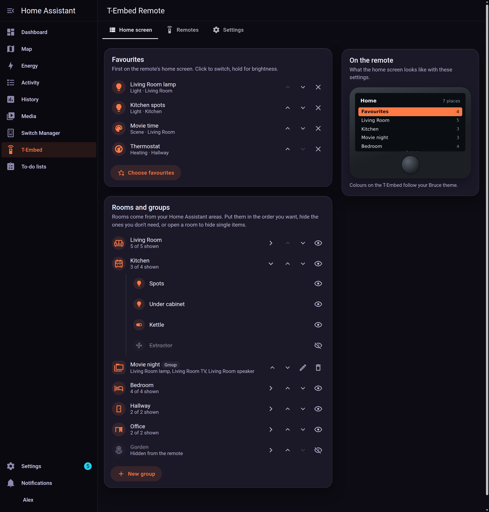
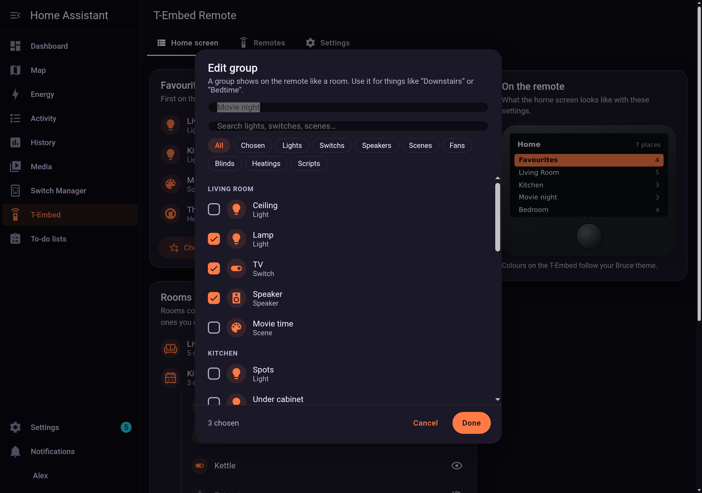
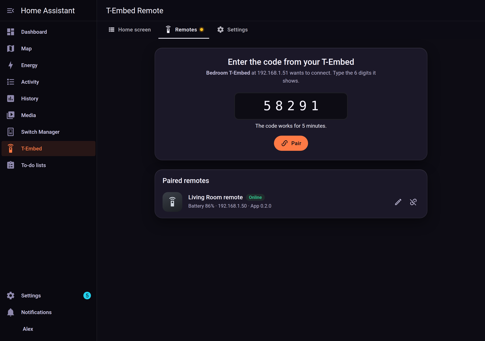
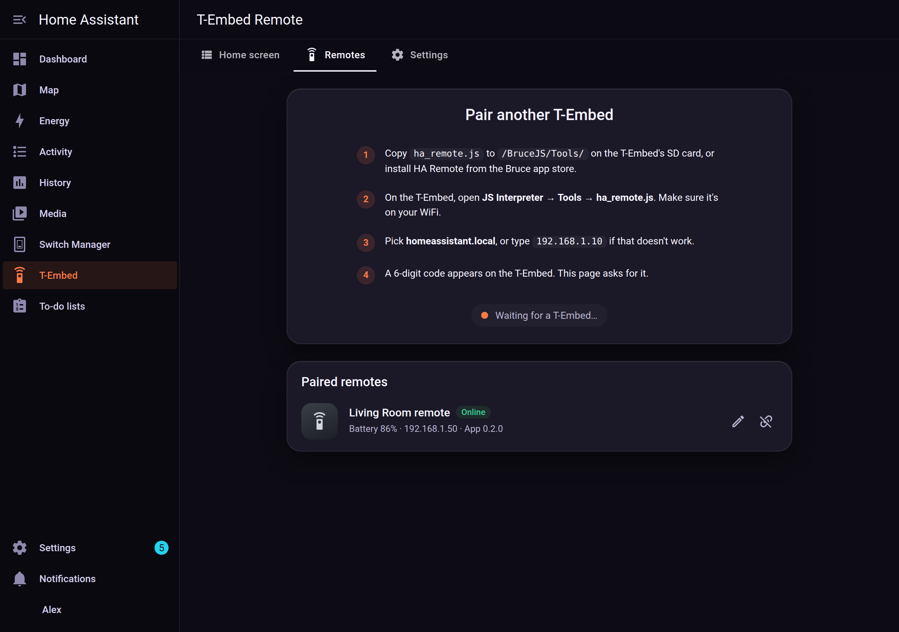
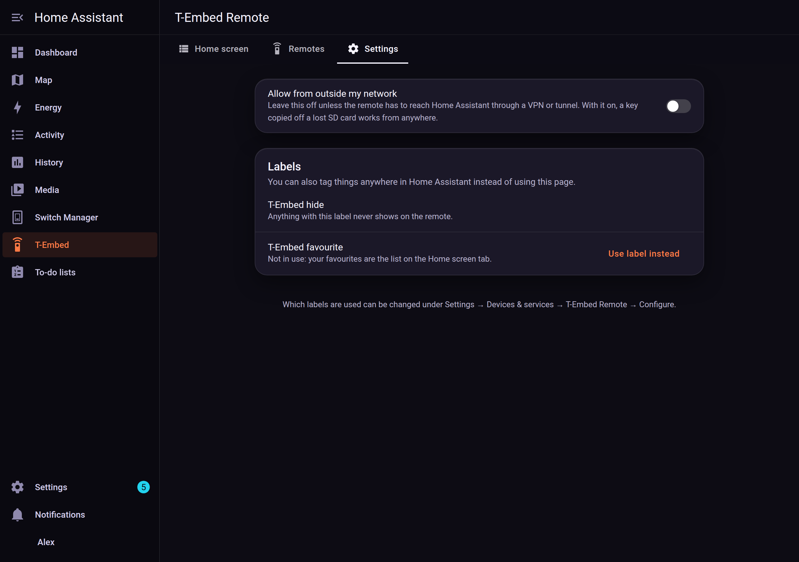

<h1 align="center">T-Embed Remote for Home Assistant</h1>

<p align="center">
  Turn a LilyGo T-Embed CC1101 into a pocket remote for your home.<br>
  Turn the dial to pick a room, click to switch things on and off, and set it all up from one page in Home Assistant.
</p>

<p align="center">
  <a href="https://my.home-assistant.io/redirect/hacs_repository/?owner=stovness&repository=tembed-ha-remote&category=integration"></a>
</p>

<p align="center">
  <a href="https://hacs.xyz"></a>
  
  
</p>

<p align="center">
  
</p>

## What it does

- **Your rooms, on a dial.** The remote reads your Home Assistant Areas and
  shows each one with what is on in it. Favourites sit at the top.
- **Lights, switches, fans, scenes, scripts, heating, blinds and speakers.**
  Click to toggle, hold to dim or set a temperature, volume or position.
- **Set up from a page, not YAML.** A **T-Embed** page in the sidebar picks
  favourites, orders rooms, hides what you never use and builds your own
  groups, with a live preview of the remote's screen.
- **Pair with a six digit code.** No tokens to copy and no config files to
  edit. Each remote gets its own key, and you can remove one at any time.
- **Follows your Bruce theme.** The remote uses the colours you picked in
  Bruce.

## The T-Embed page

Everything is set up from **T-Embed** in the Home Assistant sidebar. Changes
save as you make them and remotes pick them up within 30 seconds.

### Home screen

Pick favourites, put rooms in order, hide a room with the eye, or open a room
to hide single things in it. The preview on the right shows what the remote
will look like.



### Groups

**New group** makes your own list, such as "Movie night", "Downstairs" or
"Bedtime". It mixes things from any room and shows on the remote like a room.



### Pairing a remote

Open the app on the T-Embed and it shows a code. The Remotes tab notices the
remote by itself, so you only type the six digits.



Paired remotes are listed underneath with battery, last seen time and app
version. Rename or remove them from here.



### Settings



## What you need

- A **LilyGo T-Embed CC1101** running [Bruce](https://bruce.computer) firmware,
  with a microSD card.
- **Home Assistant 2026.2 or newer**, with [HACS](https://hacs.xyz).
- The remote and Home Assistant on the same WiFi network.

## Install

### 1. Add the integration to Home Assistant

**With HACS (recommended)**

1. Click the button below, or in HACS open the three dot menu, choose
   **Custom repositories**, paste
   `https://github.com/stovness/tembed-ha-remote` and pick **Integration**.

   [](https://my.home-assistant.io/redirect/hacs_repository/?owner=stovness&repository=tembed-ha-remote&category=integration)

2. Click **Download**, then restart Home Assistant.
3. Add the integration. There is nothing to fill in.

   [](https://my.home-assistant.io/redirect/config_flow_start/?domain=tembed_remote)

   Or go to **Settings**, **Devices and services**, **Add integration** and
   search for "T-Embed Remote".

**Without HACS**

Copy `custom_components/tembed_remote` from this repository into the
`custom_components` folder of your Home Assistant config, restart, then add
the integration as in step 3.

A **T-Embed** item now appears in the sidebar for admin users.

### 2. Put the app on the T-Embed

1. Download [`ha_remote.js`](ha_remote.js).
2. Copy it to `/BruceJS/Tools/` on the T-Embed's SD card. Use a card reader:
   sending a file this size over USB serial cuts it short, and the app then
   fails to start.
3. On the T-Embed open **JS Interpreter**, then **Tools**, then
   **ha_remote.js**.

### 3. Pair

1. The first time, the remote asks where Home Assistant is. Pick
   `homeassistant.local`, or type your Home Assistant address such as
   `192.168.1.10`. The `http://` and port are filled in for you.
2. The remote shows a six digit code.
3. In Home Assistant open **T-Embed**, go to **Remotes** and type the code.
   A notification with a link also appears when a remote asks to connect.

The remote loads your rooms straight away. The code lasts five minutes and
five wrong tries cancel it. Click the dial on the remote for a new one.

## Using the remote

- **Turn** the dial to move, or to change a value.
- **Click** to open a room, or to switch the selected thing on or off.
- **Hold** for just over half a second to open the dimmer, heating, blind or
  volume screen.
- **Side button** goes back. From Home it closes the app.

A click flips a light, switch or fan straight away and then confirms from
Home Assistant. Scenes and scripts run on click. Heating opens its own
screen. A blind opens when closed, closes when open and stops while moving. A
speaker plays or pauses.

On a value screen, turn the dial and the remote sends the new value once the
dial has been still for a moment.

## Good to know

- **Names are shortened.** "Bedroom lamp" in the Bedroom shows as "Lamp".
  Groups mix rooms, so they keep the full name.
- **Hidden and disabled entities are left out,** and empty rooms are skipped.
- **Labels still work.** Anything labelled `t_embed_hide` never shows. Until
  you choose favourites on the page, they come from the `t_embed_favourite`
  label. **Use label instead** on the Home screen tab goes back to that.
- **Only admins see the T-Embed page.** Each remote can only control what the
  page puts on it.
- **Remotes outside your network** are refused unless you turn that on under
  Settings. Leave it off unless the remote reaches Home Assistant through a
  VPN or tunnel.

## Troubleshooting

**`No WiFi`.** The T-Embed isn't connected. Connect from the Bruce WiFi menu.
If it drops after a restart, turn on WiFi at startup in Bruce's settings.

**`Can't reach Home Assistant`.** The address is wrong or Home Assistant is
down. The remote retries every two minutes.

**`Not connected` while pairing.** The address is wrong or the integration
isn't installed yet. Check both, then click the dial to try again.

**`Not allowed`.** Home Assistant refused that remote for the thing you
picked. Remove the remote under Remotes and pair again.

**The remote went back to the pairing screen.** It was removed in Home
Assistant. Pair it again with the new code.

**The app shows a blank screen or a syntax error.** The file on the SD card
is incomplete. Copy `ha_remote.js` again with a card reader.

**The side button leaves the app instead of going back.** Update to the
latest `ha_remote.js`. Older versions read one press as two.

## For developers

Two pieces live in this repository:

- `ha_remote.js` runs on the T-Embed under Bruce's JavaScript engine
  (mquickjs, so it is written in ES5 style).
- `custom_components/tembed_remote` is the integration. It builds the room
  list, answers the remote over HTTP and serves the sidebar page, a single
  web component with no build step.

The protocol is described in [docs/api.md](docs/api.md). Both pieces are the
shipped code: the app is plain ES5 and the sidebar page is a single web
component with no build step.

<details>
<summary>The older token setup</summary>

The app still understands the original `ha_config.json` with a long lived
token and the `sensor.t_embed_panel` template sensor:

```json
{"url":"http://192.168.1.10:8123","token":"PASTE_LONG_LIVED_TOKEN"}
```

If a `key` is present the app uses the integration, otherwise it falls back
to the token. New installs should pair instead. Never commit `ha_config.json`
or paste a token into an issue.

</details>

<details>
<summary>Engine versions it was checked against</summary>

- Bruce firmware `BruceDevices/firmware` commit
  `a59213f3ec6cd302fa32c2042b2700c9c24d991a`.
- The pinned engine `BruceDevices/mquickjs` tag `0.0.6`, commit
  `169b5ea7723bf43d7be9631a14f9c2a1ed8c69e1`.
- Bruce JS tooling `BruceDevices/bruce-js-tooling` commit
  `8233f0582acccad622683ed7dc7d63f6886db2e5`.
- Bruce 1.17 is supported. It stops a running script on any Esc press, even
  mid-draw, so the app calls `runtime.toForeground()` at start to turn that
  off and handles Esc itself.

</details>
